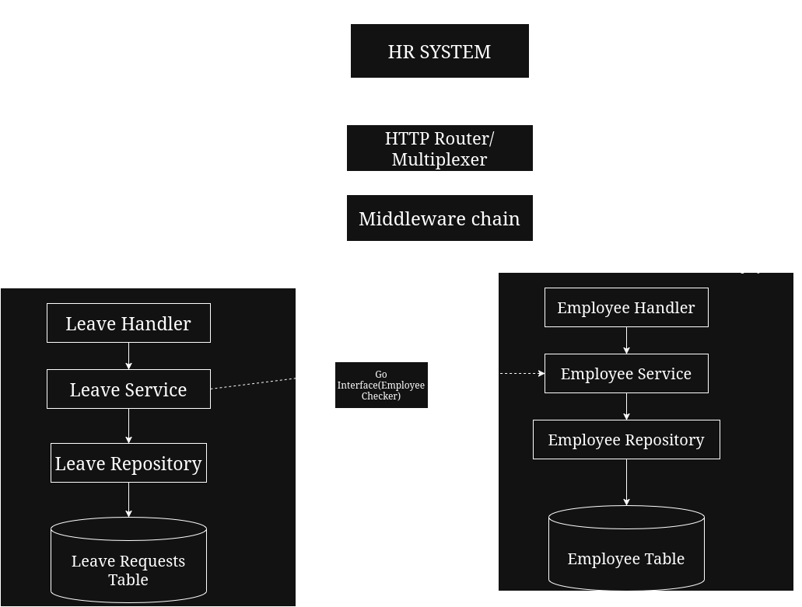

# Overview

The system has two independent packages:
- `internal/employee`: manages employee records, roles, and profiles.
- `internal/leave`: manages leave requests, date validation and approvals.

# Architecture Diagram

# Design Choices
- Uses Go 1.22+ standard library router(`net/http.ServeMux`)
- leave_requests table doesn't reference `employees` directly in SQL. Employee existence is verified by using `EmployeeChecker` interface
- Uses `sqlite` so it runs without a C compiler.
- protected routes check `X-User-Role` heder for authentication

# Installation Instructions

## Getting Started

### Option 1: Running with Docker(Recommended)
This is the recommened way of running this system, provides consistent environment(it works on my machine though).
- [Docker](https://docs.docker.com/get-docker)(Install docker)

#### Build the image
```bash
docker build -t hr-system
```
#### Run the container
```bash
docker run -d -p 8080:8080 hr-system
```

#### Run with database persistence:
Mount a local directory for database storage so SQLite can create and manager database and WAL files:

```bash
mkdir -p data
docker run -p 8080:8080 -v $(pwd)/data:/app/data -e DB_PATH=/app/data/hr.db hr-system
```


### Option 2: Running with GO

- [Go 1.26+](https://go.dev/doc/install)(Install Go)

If you don't want to install docker for some reason, you can just install go


### Running the Server
```bash
go run ./cmd/server
```

The server will start on port 8080 by default(unless specified otherwise in .env) and create the hr.db.

To use custom port:
`PORT=9000 DB_PATH=custom.db go run ./cmd/server`

### Running Tests

`go test -v ./...`

## 2. Examples

1. Create an employee
```bash
curl -i -X POST http://localhost:8080/api/v1/employees \
-H "Content-Type:application/json" \
-H "X-User-Role:admin" \
-d '{"name":"Hari Bahadur","email":"hari@bahadurcorp.com","department":"Engineering"}'
```
2. Submit a leave request
```bash
curl -i -X POST http://localhost:8080/api/v1/leaves \
-H "Content-Type:application/json" \
-d '{"employee_id":1,"leave_type":"ANNUAL","start_date":"2026-11-01","end_date":"2026-11-05"}'
```

3. Approve the leave(only `manager` or `admin`)
```bash
curl -i -X POST http://localhost:8080/api/v1/leaves/1/approve \
-H "X-User-Role:manager"
```
# 3. End-to-End User Flow

### Step 1: Admin adds a new Employee
```bash
curl -i -X POST http://localhost:8080/api/v1/employees \
-H "Content-Type: application/json" \
-H "X-User-Role: admin" \
-d '{
        "name":"Ram Bahadur",
        "email":"ram@honda.com",
        "department":"Sales",
        "role":"employee"
    }'
```
Returns `201 Created` with employee `id:1` and `status:"ACTIVE"`

### Step 2: Employee queries their profiles
`curl -i http://localhost:8080/api/v1/employees/1`

Returns `200 Ok` with profile details.

### Step 3: Employee submits a leave request
```bash
curl -i -X POST http://localhost:8080/api/v1/leaves \
-H "Content-Type:application/json" \
-d '{
        "employee_id":1,
        "leave_type":"ANNUAL",
        "start_date":"2026-11-01",
        "end_date":"2026-11-05",
        "reason":"Vacation"
    }'
```
Creates a leave request with `status:"PENDING"`.

### Step 4: Manager approves the leave request

```bash
curl -i -X POST http://localhost:8080/api/v1/leaves/1/approve \
-H "X-User-Role: manager"
```


# 4.Docs

- OpenAPI Specification [docs/openapi.yaml](./docs/openapi.yaml)
- API Documentation [docs/api.md](./docs/api.md)
- Database Schema [docs/schema.md](./docs/schema.md)
- Design Assumptions [docs/assumptions.md](./docs/assumptions.md)

### Inspecting the database

Because we used `modernc.org/sqlite` and embedded into the Go library, sqlite installation isn't required to run to app.
If you want to check print the schema and tables you need to install sqlite3 for your OS.

`sqlite3 hr.db ".tables"` - returns the tables in the database
`sqlite3 hr.db ".schema"` - return the schema of the database
